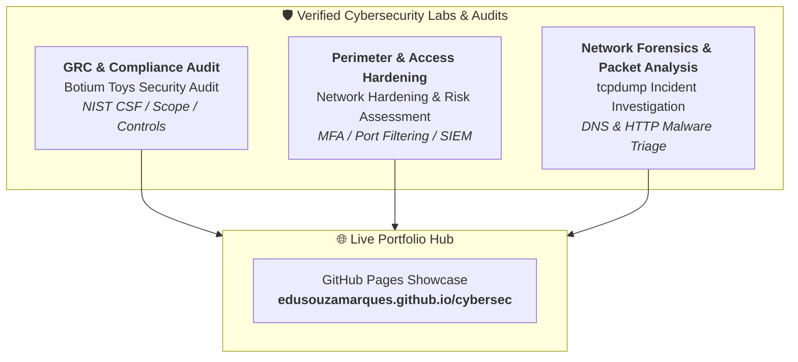

# Eduardo de Souza Marques
### AI Safety / Agent-Governance & Cybersecurity Professional

I build control planes for autonomous agents and defend enterprise digital infrastructure. My work bridges **AI safety guardrails, verifiable audit ledgers, and applied cybersecurity operations (GRC, SOC & Network Hardening)**.

---

## 🎯 Hands-on Cybersecurity Portfolio (Simulated Scenarios & Audit Labs)

A dedicated operational section showcasing hands-on incident investigations, compliance audits, and network defense simulations derived from the **Google Cybersecurity Professional Certificate** and industry standards (NIST SP 800-53 / NIST SP 800-63B / CIS Controls / GDPR):

### 📋 Practical Lab Repositories

#### 1. [🛡️ Botium Toys Security Audit (GRC & Compliance)](https://github.com/edusouzamarques/botium-toys-security-audit)
- **Focus:** Governance, Risk, and Compliance (GRC), Internal Audit, and Risk Assessment.
- **Scenario:** Comprehensive security audit of an international toy company preparing for modern digital expansion.
- **Deliverables:** Complete stakeholder-ready audit report, NIST CSF alignment matrix, scope boundaries, risk register, and [executive PDF report](https://edusouzamarques.github.io/cybersec/Botium_Toys_Security_Audit_Report.pdf).

#### 2. [🔒 Network Hardening & Security Risk Assessment Lab](https://github.com/edusouzamarques/network-hardening-security-risk-assessment)
- **Focus:** Network Defense, Perimeter Port Filtering, Password Policies, and Multi-Factor Authentication.
- **Scenario:** Remediation of a social media platform breach caused by exposed database ports, vendor-default passwords, and lack of MFA.
- **Deliverables:** Formal risk assessment report, defense-in-depth architecture, and executable Python simulation engine reproducing the breach and validating hardened controls.

#### 3. [🔍 tcpdump Incident Investigation & Packet Analysis Lab](https://github.com/edusouzamarques/tcpdump-incident-investigation-lab)
- **Focus:** Network Protocol Analysis, Incident Response, and Packet Sniffing (`tcpdump`).
- **Scenario:** Triage of a compromised web server executing unauthorized JavaScript browser redirection to a malicious domain.
- **Deliverables:** Real packet trace analysis, TCP 3-way handshake dissection, DNS/HTTP correlation, and packet analysis cheat sheet.

👉 **Explore the interactive portfolio showcase:** [edusouzamarques.github.io/cybersec](https://edusouzamarques.github.io/cybersec/)

---

## 🤖 AI Safety, Agent-Governance & Control Planes

Every library in this section exists because an autonomous agent failed in a way that generic tooling could not catch. The shared thesis: AI systems need the same properties as high-risk operational software — pre-execution gates, adversarial review, structured recovery, cost containment, and tamper-evident provenance.

### 🛡️ Safety & Governance of Autonomous Agents
- [`agent-gates`](https://github.com/edusouzamarques/agent-gates) — Pre-execution gates that intercept tool calls and return `allow` / `ask` / `deny` with a structured reason, so the host — not the model — has final authority.
- [`polycourt`](https://github.com/edusouzamarques/polycourt) — Cross-vendor LLM jury with quorum, circuit-breaker, fallback, and persisted deliberation for auditable decisions.
- [`devil-advocate`](https://github.com/edusouzamarques/devil-advocate) — Adversarial panel that attacks plans, designs, and diffs with severity-based dedup, a completeness-guard that refuses fragments, and default-REFUTED adjudication.
- [`deputy`](https://github.com/edusouzamarques/deputy) — Bounded delegation for autonomous agents: reserved zones no quorum can unlock, a cap on consecutive self-authorizations, and a journal that makes a dead mechanism visible.

### 🔁 Reliability & Recovery
- [`error-registry`](https://github.com/edusouzamarques/error-registry) — Structured error taxonomy for triage, routing, and automatic recovery without halting operations.
- [`durable-context`](https://github.com/edusouzamarques/durable-context) — Long-term memory with atomic persistence of agent session and execution state.
- [`steady-driver`](https://github.com/edusouzamarques/steady-driver) — Headless browser driver tolerant to crashes, blocks, and disconnections.

### 💰 Cost Governance (FinOps for AI)
- [`spend-guard`](https://github.com/edusouzamarques/spend-guard) — Budget kill-switch and token limiter per agent, project, and hour.
- [`gpu-spot-guard`](https://github.com/edusouzamarques/gpu-spot-guard) — Monitors spot-GPU lifecycle and checkpoints state before preemption.
- [`lane-router`](https://github.com/edusouzamarques/lane-router) — Routes simple prompts to cheap models and reserves expensive ones for reasoning — up to 85% cost reduction.

### 🧭 Tooling & Orchestration
- [`mcp-navigator`](https://github.com/edusouzamarques/mcp-navigator) — Dynamic tool index and resolver via Model Context Protocol.
- [`comfy-ui2api`](https://github.com/edusouzamarques/comfy-ui2api) — Converts ComfyUI visual workflows into production headless API endpoints.
- [`video-assembly-kit`](https://github.com/edusouzamarques/video-assembly-kit) — Programmatic video editing, cutting, concatenation, and captioning via pure ffmpeg.

### 🔗 Provenance & Audit
- [`asset-ledger`](https://github.com/edusouzamarques/asset-ledger) — Immutable ledger with cryptographic hashes for AI-generated media — provenance, anti-deepfake, chain of custody.

---

## Why a former police officer builds AI guardrails & Cybersecurity defenses

Thirteen years in the military police teaches you that systems fail at the worst possible moment, that people will exploit any ambiguity, and that a decision only matters if you can reconstruct how it was made. Chain-of-custody is not a buzzword when it has to hold up in court. I bring that same rigor to agent governance and cybersecurity: assume adversarial conditions, enforce boundaries before execution, and keep records that survive scrutiny.

---

## 📬 Stack & Contact

- **Cybersecurity Standards:** NIST CSF · NIST SP 800-53 / 800-63B · CIS Controls v8 · GDPR / LGPD · Wireshark / tcpdump · SIEM
- **AI Stack:** Python 3.9+ · zero-dependency · ~3,400 tests · CI on Linux/macOS/Windows · MIT licensed
- **Contact:** [LinkedIn — /in/edusouzamarques](https://www.linkedin.com/in/edusouzamarques) · eduardo@zemark.dev
